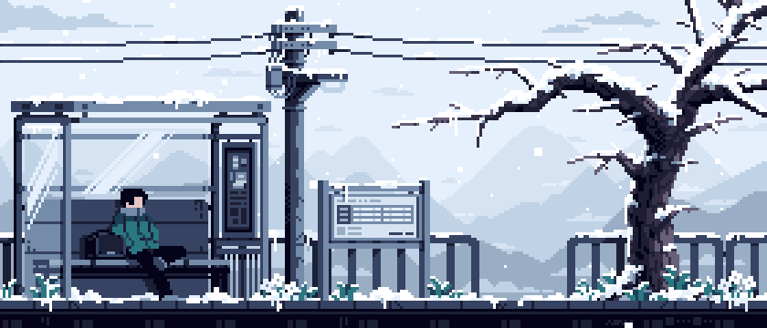

## Hi, I'm Himani Dalvi (HiX) ❄️

A B.Tech student. Most of my projects start with "why am I doing this by hand?"

### Projects

 &nbsp;**[The Scholar's Desk](https://github.com/hixyt/scholars-desk)** · reads new AI papers every morning and explains them simply · [website](https://hixyt.github.io/scholars-desk/)

 &nbsp;**[VELORA](https://github.com/hixyt/VELORA-PH1)** · finds local business leads and scores them with AI, built with no code

 

<b>What I use</b>

 

n8n, Gemini, Groq and GitHub Actions for the automation side.

### Contact me

 &nbsp;LinkedIn · [himani-dalvi](https://www.linkedin.com/in/himani-dalvi-5b68b821b/)

 &nbsp;Email · [himanidalvi4@gmail.com](mailto:himanidalvi4@gmail.com)

 &nbsp;Website · [The Scholar's Desk](https://hixyt.github.io/scholars-desk/)
