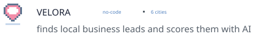

## Hi, I'm Himani Dalvi (HiX) ❄️

A B.Tech student. Most of my projects start with "why am I doing this by hand?"

 

<picture><source media="(prefers-color-scheme: dark)" srcset="assets/dark/h-projects.svg"></picture>

<a href="https://hixyt.github.io/scholars-desk/"><picture><source media="(prefers-color-scheme: dark)" srcset="assets/dark/proj-desk.svg"></picture></a>

<a href="https://github.com/hixyt/VELORA-PH1"><picture><source media="(prefers-color-scheme: dark)" srcset="assets/dark/proj-velora.svg"></picture></a>

 

<picture><source media="(prefers-color-scheme: dark)" srcset="assets/dark/h-tools.svg"></picture>

<picture><source media="(prefers-color-scheme: dark)" srcset="assets/dark/tools.svg"></picture>

 

<picture><source media="(prefers-color-scheme: dark)" srcset="assets/dark/h-contact.svg"></picture>

<a href="https://www.linkedin.com/in/himani-dalvi-5b68b821b/"><picture><source media="(prefers-color-scheme: dark)" srcset="assets/dark/btn-linkedin.svg"></picture></a>&nbsp;
<a href="https://mail.google.com/mail/?view=cm&fs=1&to=himanidalvi4@gmail.com"><picture><source media="(prefers-color-scheme: dark)" srcset="assets/dark/btn-email.svg"></picture></a>
