  
  
  

##  Projects

  
  

Tap a ticket to open the project.

 <b>What I use</b>

 

n8n for automations, Gemini and Groq for the AI parts, and GitHub Actions to run things on a timer.

 <b>Right now</b>

 

- B.Tech in AI and Data Science at Ramdeobaba University, Nagpur
- Adding new things to The Scholar's Desk
- Google Cloud skill badges: 7 done

 <b>Work with me</b>

 

Small freelance projects: n8n automations, AI workflows, and simple websites. Message me on [LinkedIn](https://www.linkedin.com/in/himani-dalvi-5b68b821b/).

